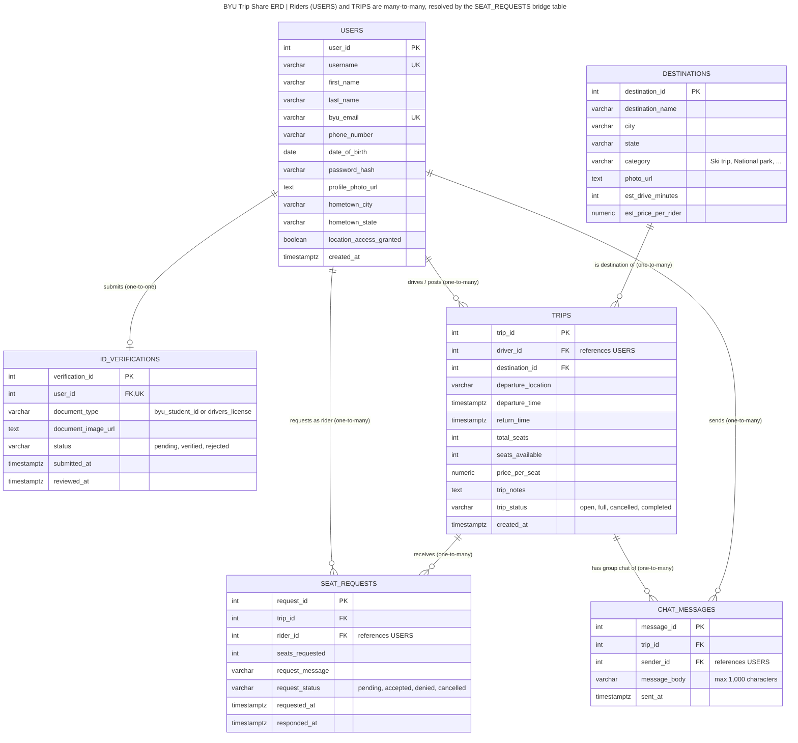

# BYU Trip Share

## App Summary

BYU students regularly travel to the same places, like Salt Lake City, Park City, Moab, St. George, and home for the holidays, but most of them drive alone or scramble to find rides through scattered group chats and Facebook posts. Students without cars struggle to get anywhere outside Provo, and students with cars pay for gas on seats that sit empty. Existing ride apps like Uber are too expensive for long trips and don't connect students with other students they can trust. BYU Trip Share is a web app where verified BYU students can post trips they're already taking and other students can request a seat. Drivers set the departure time, number of seats, and price per seat, then accept or deny each request. Once a rider is accepted, they join a group chat with the driver and other riders to coordinate pickup. A home page with popular destinations and estimated prices helps students discover trips they might not have planned.

## ERD



| Entity | What it stores | Key relationships |
|---|---|---|
| `users` | Every BYU student account (drivers and riders are both users) | One-to-many with `trips` (as driver), `seat_requests` (as rider), and `chat_messages` |
| `id_verifications` | The student ID or driver's license uploaded at sign-up, and its review status | One-to-one with `users` |
| `destinations` | Destination cards on the Home / Search screen, with estimated drive time and price | One-to-many with `trips` |
| `trips` | A trip a driver posts: destination, departure, seats, price, status | One-to-many with `seat_requests` and `chat_messages` |
| `seat_requests` | A rider's request to join a trip and whether the driver accepted it | Bridge table that resolves the **many-to-many** between riders (`users`) and `trips` |
| `chat_messages` | Messages in each trip's group chat (1,000-character limit) | Many-to-one with `trips` and `users` |

The Mermaid source for the diagram is in [`docs/erd.mmd`](docs/erd.mmd), and the SQL that builds it is in [`db/schema.sql`](db/schema.sql).

> **Note on login:** `password_hash` is in the model because our Sign Up screen collects a password. If we later switch to Supabase Auth or BYU NetID sign-in, that column goes away, because the auth provider stores credentials for us.

## Tech Stack

| Layer | What we used | Why |
|---|---|---|
| Frontend | Plain HTML, CSS, and JavaScript (`app/`) | No build tools or installs. Anyone on the team can open `index.html` and see the app. |
| Backend | [Supabase](https://supabase.com) auto-generated API, calling three PostgreSQL functions in `db/functions.sql` | Supabase gives us an API without writing or hosting our own server. The functions hold the business rules, like no double requests, no requesting a full trip, and drivers can't request their own trip. |
| Database | PostgreSQL, hosted by Supabase | Our data is relational: users, trips, requests, and messages all link to each other, and Postgres enforces those links with foreign keys. |
| Client library | `supabase-js` v2.45.4, loaded from the jsDelivr CDN | Lets the browser call our database functions in one line. |
| Secrets | `app/config.js`, listed in `.gitignore` | The project URL and key stay out of the shared repo. Each teammate creates their own copy from `app/config.example.js`. |

**Why this approach fits our team:** Supabase gives us a real PostgreSQL database on the free tier, with a visual Table Editor, so every teammate can see the tables and data without installing anything. That matters because we're all learning SQL in IS 402 at the same time. We still write our own SQL for the schema and business rules, so we can see and explain every part of the backend, which an AI app builder would hide from us. Using plain HTML/JS on the frontend keeps setup at zero, so we spend our time on the data model instead of on tooling.

**Security:** Row Level Security is turned on for every table with no public policies, so the browser can't read or change tables directly. That protects data like phone numbers and birthdays. The browser can only call the three functions in `db/functions.sql`, and each one returns just the fields the page needs.

## How to Get It Running

You need a free Supabase account and a web browser. Nothing else needs to be installed.

### 1. Get the code
```bash
git clone TODO-our-repo-url
cd TODO-our-repo-folder
```
(Or download the repo as a ZIP from GitHub and unzip it.)

### 2. Set up the database
*Skip this step if you're joining the team's existing Supabase project. Just ask for an invite.*

1. Go to [supabase.com](https://supabase.com), sign in, and click **New project**. Any name and region work. Save the database password somewhere.
2. When the project finishes setting up, open **SQL Editor** in the left sidebar.
3. Run these three files **in order**. For each one, click **New query**, paste in the whole file, and click **Run**:
   1. `db/schema.sql` creates the six tables.
   2. `db/seed.sql` adds the sample data.
   3. `db/functions.sql` turns on security and creates the functions the app calls.
4. Open **Table Editor** and check that all six tables have rows.

### 3. Add your keys
1. In Supabase, go to **Project Settings → API**. Copy the **Project URL** and the **anon public** key. Newer projects may call it the **publishable** key.
2. In the `app/` folder, make a copy of `config.example.js` and name it `config.js`.
3. Paste your two values into `config.js` and save. Git ignores `config.js`, so it will never be committed.

### 4. Open the app
Double-click `app/index.html` to open it in your browser. You should see four upcoming trips.

If your browser blocks the page when it's opened as a file, serve the folder instead. Either run `npx serve app` and open the URL it prints, or use VS Code's **Live Server** extension.

## Verifying the Vertical Slice

**Button:** **Request a Seat** on a trip card.

**What happens when you click it:**
1. **Request:** the browser calls `request_seat(trip_id, rider_id)` through the Supabase API.
2. **Update:** the function checks the trip is open and the rider hasn't already asked, then inserts a new row into `seat_requests` with `request_status = 'pending'`.
3. **Return:** the function sends the saved row back to the browser, including its new `request_id` and timestamp.
4. **Display:** the button changes to **Request Pending**, with "Saved to database · request #… · time" under it.

**Steps to verify:**
1. Open the app. The **Signed in as (demo)** menu defaults to **Tanner Brooks**. This menu stands in for real login in this prototype.
2. Find the **Park City** trip (driver Emily, Sat Oct 24) and click **Request a Seat**.
3. The button changes to **Request Pending** and shows the saved request number.
4. **Refresh the page.** The button still says **Request Pending**, because the page reads the status back from the database, not from the browser.
5. Optional: in Supabase, open **Table Editor → seat_requests** and find the new row for `trip_id = 2`, `rider_id = 3`.
6. Optional: switch the menu to **Kevin Chen**. The page reloads his statuses from the database, so you'll see "You're driving" on his own trip and "Trip Full" on the Salt Lake City trip.

**To reset the demo:** delete the new row in **Table Editor → seat_requests**, or rerun all three SQL files in order.
